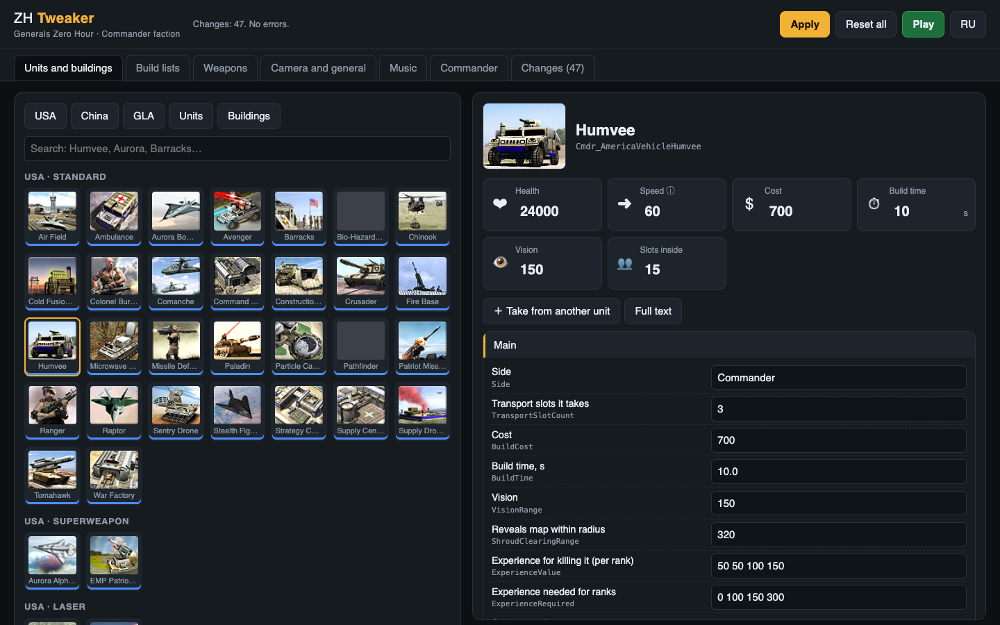
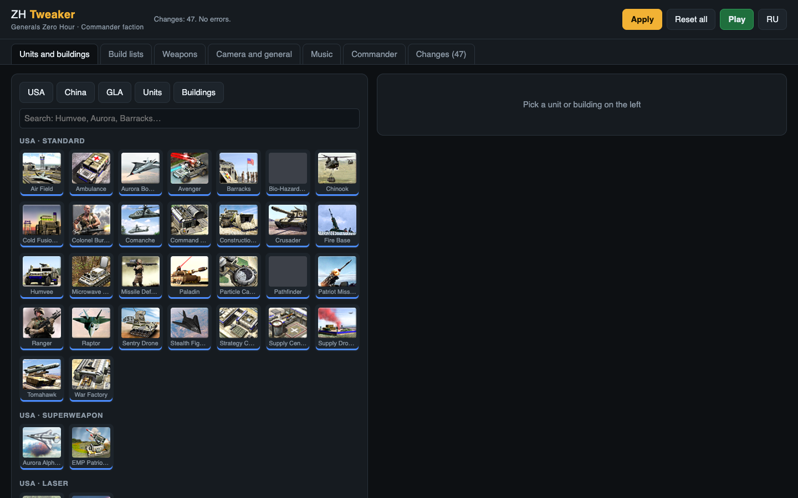
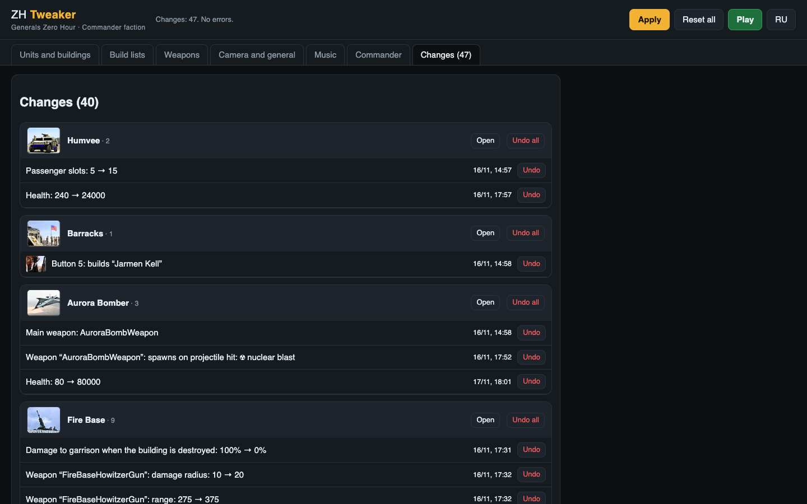
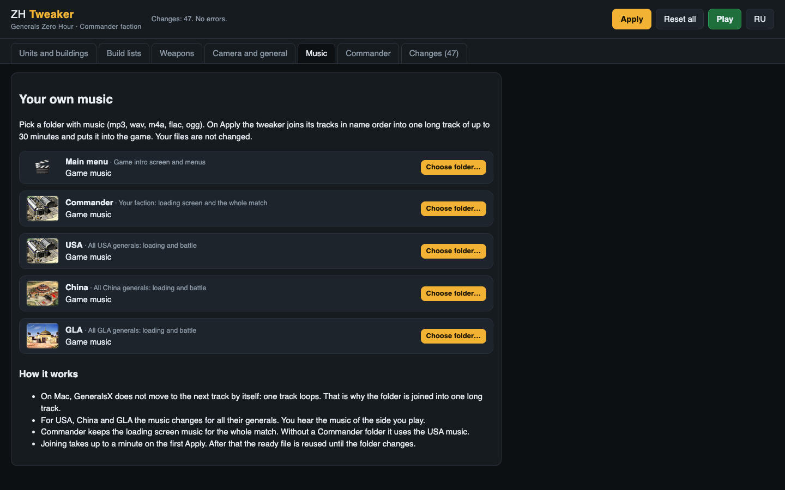

# ZH Tweaker: unit editor for C&C Generals Zero Hour on Mac

**Edit any unit, building and weapon in Command & Conquer Generals Zero Hour on macOS, right from your browser.** No INI files, no Windows, no mod tools. Works with [GeneralsX](https://github.com/fbraz3/GeneralsX), the native Apple Silicon port.

[Русская версия](README.ru.md) · [Full guide and FAQ](docs/GUIDE.md) · [Подробная инструкция](docs/GUIDE.ru.md)



## What you get

- **Commander**, a new faction with every unit, building and general power from USA, China, GLA and all nine generals.
- Change **health, speed, cost, build time, vision, passenger slots, power, income** with one click.
- Swap **weapons**, tune damage, range, reload and projectiles.
- Make **any building build any unit**.
- **Camera height up to 690** to see the whole battlefield.
- **Your own music**: pick a folder for the main menu, Commander, USA, China and GLA.
- Fixes for big battles: missile smoke trails and weapon sounds stay on.
- A readable change list grouped by unit ("240 → 24000"), with undo for each change.
- Real game icons everywhere. Vanilla factions and the AI are not changed.

## Install

You need an Apple Silicon Mac with macOS 15+ and Zero Hour running through [GeneralsX](https://github.com/fbraz3/GeneralsX). Open Terminal and paste:

```bash
curl -fsSL https://raw.githubusercontent.com/deanlawkz/zh-tweaker/main/install.sh | bash
```

A **ZH Tweaker** icon appears in Applications. Node.js is downloaded automatically if you don't have it. Run the same command to update; your changes are kept.

## Use

1. Open **ZH Tweaker** (it opens http://127.0.0.1:4170).
2. Change what you want, press **Apply**, then **Play**.
3. Pick **Commander** in the skirmish lobby.







The interface is in English and Russian (switch with the EN/RU button). It picks your browser language on first run.

## FAQ

- **Does it change my game files?** No. Game archives are read only. The tweaker adds separate `ZHT_*.ini` files that the engine loads on top, and **Reset all** removes them.
- **Can I play online with it?** No, opponents would desync. Reset before online games.
- **Intel Mac?** GeneralsX supports Apple Silicon only.
- **Windows?** No, this is a Mac tool.
- **Contra / TEOD mods?** Planned.
- **Uninstall?** `curl -fsSL https://raw.githubusercontent.com/deanlawkz/zh-tweaker/main/uninstall.sh | bash`

More situations and fixes: [docs/GUIDE.md](docs/GUIDE.md).

## For developers

```bash
git clone https://github.com/deanlawkz/zh-tweaker.git && cd zh-tweaker
npm start   # http://127.0.0.1:4170
npm test
```

Plain Node.js, no dependencies. It reads `.big` archives and `generals.csf`, builds the Commander faction from vanilla INI and writes override files into `Data/INI/<Type>/` ([how it works](docs/override-mechanism.md)). Pull requests and issues are welcome.

## Legal

Unofficial fan project, not affiliated with Electronic Arts. No game files are included: you need your own copy of Zero Hour. Command & Conquer and Generals are trademarks of Electronic Arts Inc. Code under the [MIT license](LICENSE).
