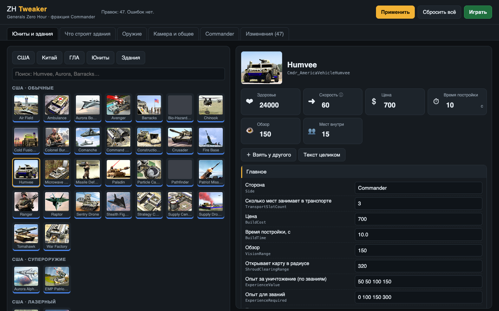
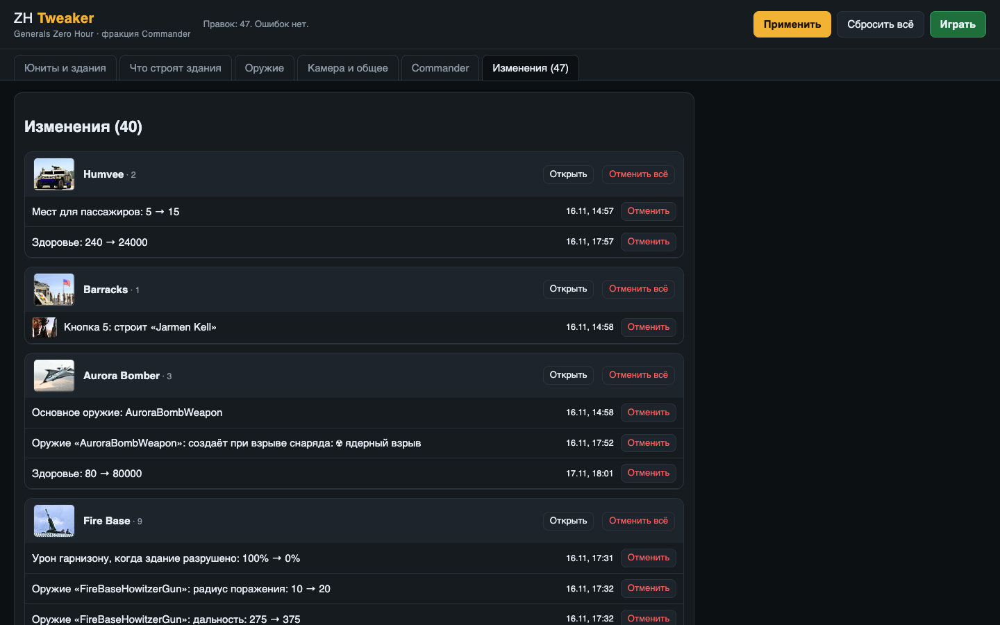

# ZH Tweaker: редактор юнитов C&C Generals Zero Hour для Mac

Твикер для **C&C Generals Zero Hour** на Mac (нативный порт [GeneralsX](https://github.com/fbraz3/GeneralsX)). Меняет юнитов, здания и оружие прямо в браузере, без ручной правки INI и без Windows.

[English](README.md) · [Подробная инструкция и ответы на вопросы](docs/GUIDE.ru.md)



Добавляет в игру фракцию **Commander**: у неё есть все юниты, здания и генеральские способности всех сторон. Любую из этих вещей можно поменять в окне браузера, с иконками из игры:

- здоровье, скорость, цена, время постройки, обзор, места внутри транспорта;
- энергия, доход, ящики на складе, очередь постройки;
- оружие юнитов, урон, дальность, перезарядка;
- что строит каждое здание;
- высота камеры (до 690);
- своя музыка: папка для главного меню, Commander, США, Китая и ГЛА;
- дым и звук ракет в больших боях.

Обычные фракции и ИИ не меняются, правки касаются только Commander.

## Что нужно

- Mac на Apple Silicon (M1 и новее) с macOS 15 или новее. На Intel GeneralsX не работает.
- Установленный **GeneralsX** с данными Zero Hour (своя лицензионная копия игры, например из Steam). Твикер ищет игру в `~/GeneralsX/GeneralsZH` и `~/GeneralsX/Generals`.
- Node.js 22.13 или новее. Если его нет, установщик сам скачает Node.js с nodejs.org в папку твикера.

## Установка

Откройте Терминал и вставьте одну команду:

```bash
curl -fsSL https://raw.githubusercontent.com/deanlawkz/zh-tweaker/main/install.sh | bash
```

Установщик кладёт твикер в `~/Library/Application Support/ZH Tweaker` и создаёт значок **ZH Tweaker** в Программах. Значок запускает твикер и открывает страницу http://127.0.0.1:4170.

Обновление: та же команда. Ваши правки при этом сохраняются.

## Как пользоваться

1. Откройте **ZH Tweaker**.
2. Поменяйте что нужно на вкладках «Юниты и здания», «Что строят здания», «Оружие», «Камера и общее».
3. Нажмите **Применить**.
4. Запустите игру и в лобби выберите фракцию **Commander**.



Все правки видны на вкладке «Изменения»: по юнитам, в виде «было → стало». Любую можно отменить. **Сбросить всё** убирает из игры все файлы твикера.

## Как это работает

- Архивы игры (`*.big`) только читаются, оригинальные файлы не меняются.
- Правки хранятся в `~/GeneralsX/zh-tweaker/tweaks.json`.
- «Применить» пишет отдельные файлы `Data/INI/<Тип>/ZHT_*.ini` и `Data/English/generals.csf` в папку игры. Движок читает их вместе с архивами (подробнее в [docs/override-mechanism.md](docs/override-mechanism.md)).
- Высота камеры пишется в `~/Library/Application Support/GeneralsX/GeneralsZH/SagePatch.ini`, рядом остаётся копия `.zht-backup`.

## Ограничения

- Проверено с GeneralsX 1.0.7 и английской версией Zero Hour.
- Играть с правками по сети нельзя: у соперника другие данные.
- Моды (Contra, TEOD) пока не поддерживаются.

## Удаление

```bash
curl -fsSL https://raw.githubusercontent.com/deanlawkz/zh-tweaker/main/uninstall.sh | bash
```

Убирает файлы твикера из игры, значок и программу. Правки остаются в `~/GeneralsX/zh-tweaker`.

## Если что-то пошло не так

Игра в другой папке, нет игры на Маке, русская версия, значок не открывается, игра вылетает, сетевая игра: всё это разобрано в [подробной инструкции](docs/GUIDE.ru.md).

## Для разработчиков

```bash
git clone https://github.com/deanlawkz/zh-tweaker.git
cd zh-tweaker
npm start   # http://127.0.0.1:4170
npm test
```

Зависимостей нет. Тесты на реальных данных пропускаются, если игры нет.

## Правовое

Неофициальный проект, не связан с Electronic Arts. Файлы игры в репозитории отсутствуют: нужна своя копия Zero Hour. Command & Conquer и Generals являются товарными знаками Electronic Arts Inc. Код распространяется по лицензии MIT, см. [LICENSE](LICENSE).
